# Part F — Working Sprint 1 and verification

**Release under assessment:** tag [`v0.1.1`](https://github.com/Nuggetkub/cpe334-course-project-management-system/releases/tag/v0.1.1) on `main`. It is a documentation-only release on top of [`v0.1.0`](https://github.com/Nuggetkub/cpe334-course-project-management-system/releases/tag/v0.1.0) (commit `d8bbb4d`, release PR #39, 6 Nov 2026), which shipped the Sprint 1 code. `v0.1.1` adds the Product Definition of Done, the completed DoD status in each contract, this evidence, and one README setup step (PR #41). It changes no application or test file: `git diff --stat v0.1.0 v0.1.1 -- client server e2e playwright.config.ts package.json package-lock.json` is empty. So every result and screenshot in this part, all produced from `v0.1.0`'s source, applies to `v0.1.1` unchanged. The screenshots were taken on branch `docs/12-d1-evidence` at `23782ca`, whose file tree is byte-identical to `v0.1.0` (`git rev-parse v0.1.0^{tree}` = `23782ca^{tree}` = `4859ba3`). The four GitHub screenshots in F.6 are public pages captured on 6 Nov 2026.

## F.1 Setup summary

The full instructions are in the README. In short:

| Step | Command |
|---|---|
| Prerequisites | Node.js 24, PostgreSQL 16 (Docker: `docker compose up -d db`, port 5433) |
| API | `cd server`, `cp .env.example .env`, `npm install`, `npx prisma generate` (see F.4, TEST-SR2.2), `npx prisma migrate deploy`, `npm run prisma:seed`, `npm run dev` (port 3000) |
| UI | `cd client`, `cp .env.example .env`, `npm install`, `npm run dev` (port 5173) |
| Demo accounts | Seed is opt-in: set `SEED_DEMO_DATA=true` and choose `STUDENT_DEMO_PASSWORD` / `SUPERVISOR_DEMO_PASSWORD` in `server/.env` (never committed). Accounts and teams are synthetic. |
| Tests | `npm test` in `server/` (Vitest + Supertest on schema `cpms_test`) and `client/` (Vitest + Testing Library); `npm run e2e` at the root (Playwright; resets schema `cpms_e2e`, API on 3101, UI on 4173) |

The demonstrations below use the Playwright fixture accounts (`student@e2e.test`, `student2@e2e.test`, `supervisor@e2e.test`), created by `server/scripts/e2e-prepare.ts` in the disposable `cpms_e2e` schema. Their password is a fixed test-only value that exists in no other database.

## F.2 Program demonstrations

All screenshots show the real UI talking to the real API and PostgreSQL. A temporary Playwright script drove the browser so that every step is repeatable (see the AI-use declaration, F.8). The script was not committed; it ran the same `cpms_e2e` setup as `npm run e2e`.

**Fixtures** (from `e2e-prepare.ts`):
- **E2E Journey Team:** `student@e2e.test` is its member and `supervisor@e2e.test` is assigned; it starts with no milestones.
- **E2E Submission Team:** `student2@e2e.test` is its member and the same Supervisor is assigned. It has "F05 past milestone", due 24 h ago, and "F06 submitted milestone", already submitted by Student 2.

### Scenario 1 — Complete domain journey with persisted retrieval

| | |
|---|---|
| **Features / AC** | F-01 (AC-01.1, AC-01.7), F-04 (AC-04.1, AC-04.3), F-05 (AC-05.1, AC-05.7, AC-05.8), F-06 (AC-06.1, AC-06.5) |
| **Roles** | Supervisor, then Student, then Supervisor, then Student |
| **Starting condition** | E2E Journey Team has no milestones |
| **Steps** | 1. The Supervisor signs in and creates the milestone "Sprint 1 prototype", due in 7 days. 2. The Student signs in, opens it, submits a title, description and link, and reloads the page. 3. The Supervisor opens the submission and adds feedback. 4. The Student opens the milestone again and reloads. |
| **Expected** | Each step is stored in the database and survives a reload. Status changes from Not submitted to Submitted. The feedback shows its author, time (ICT) and version 1. |
| **Actual** | As expected. Figures 1–7. |

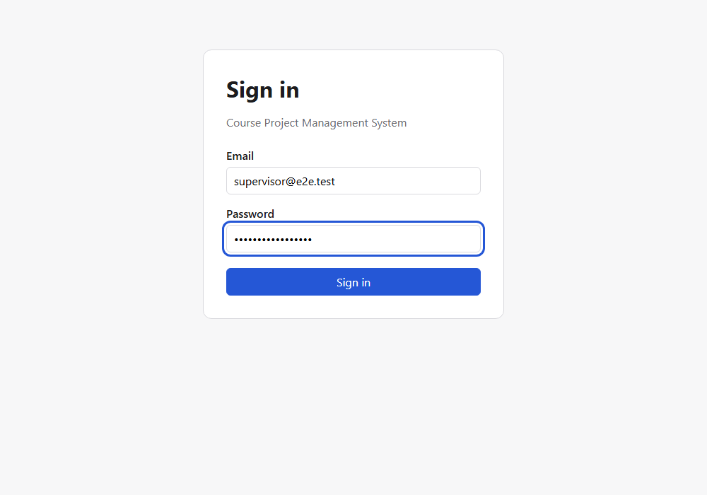

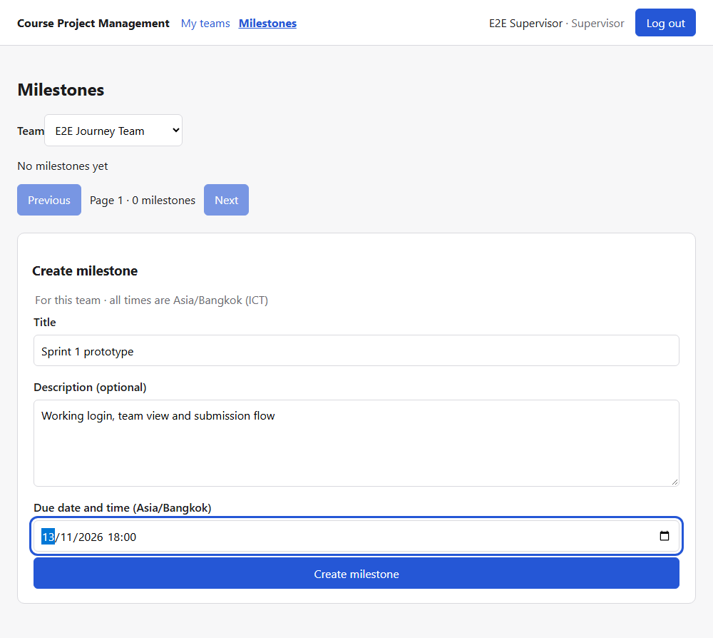

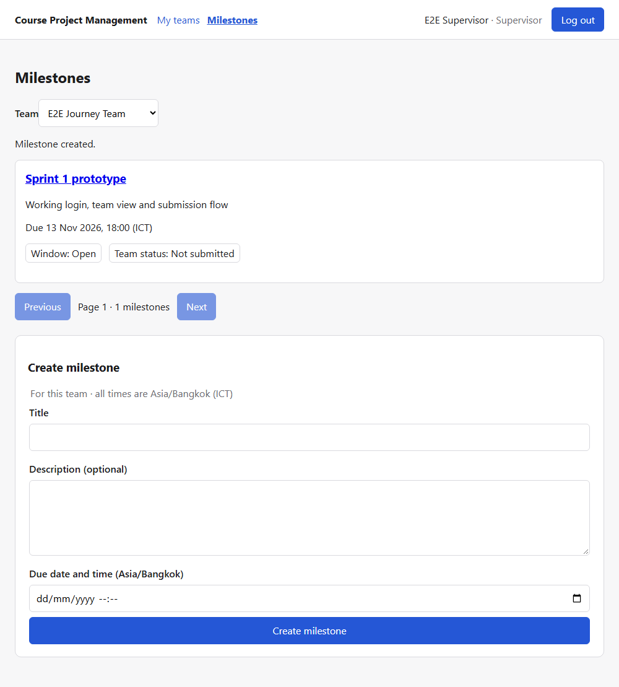

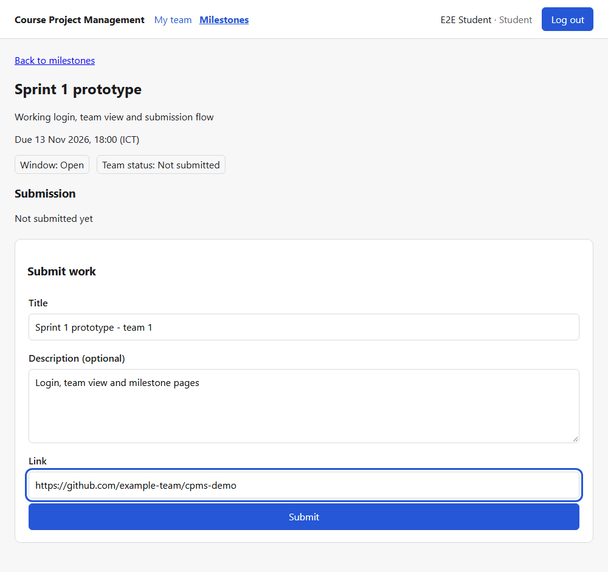

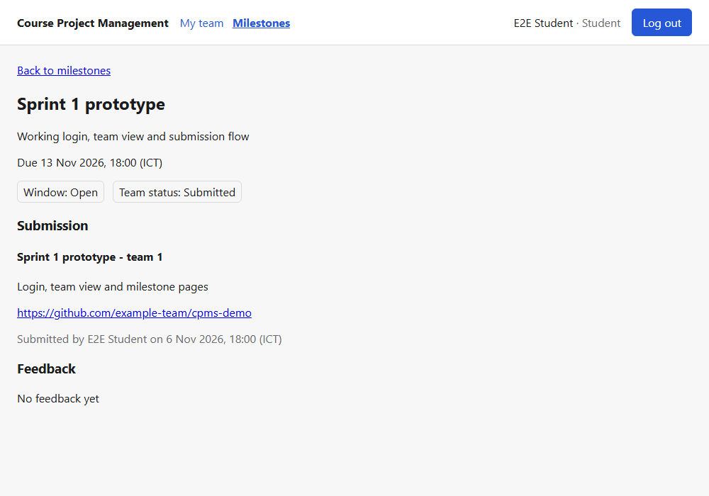

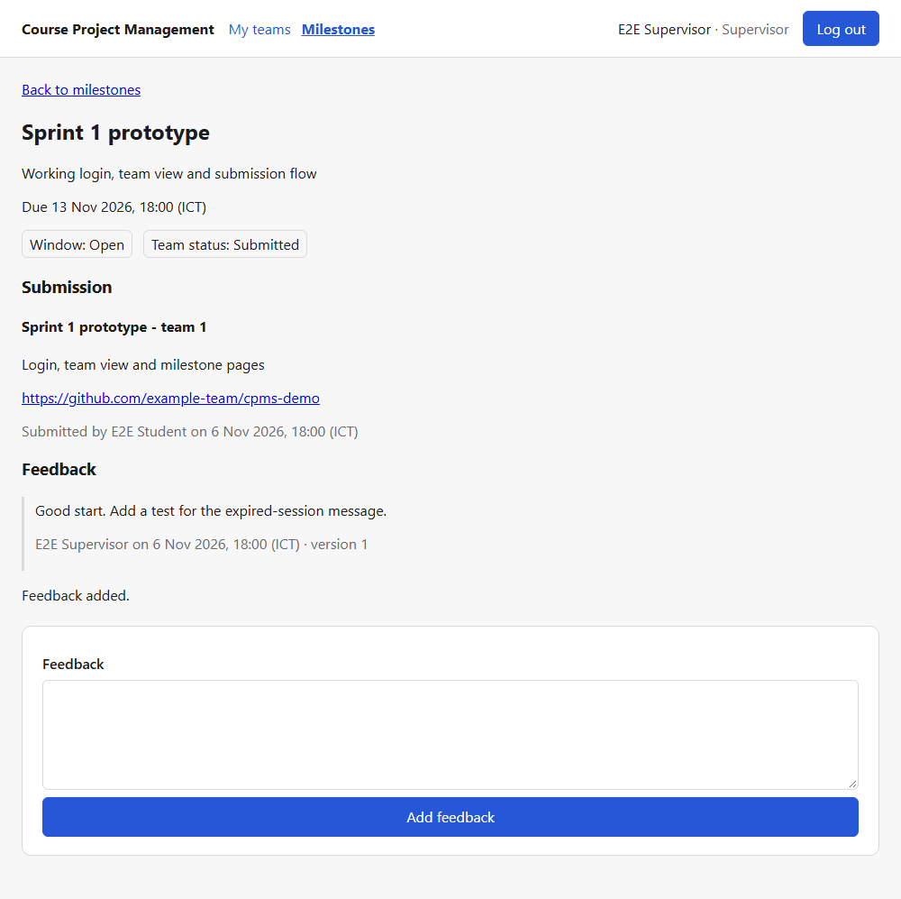

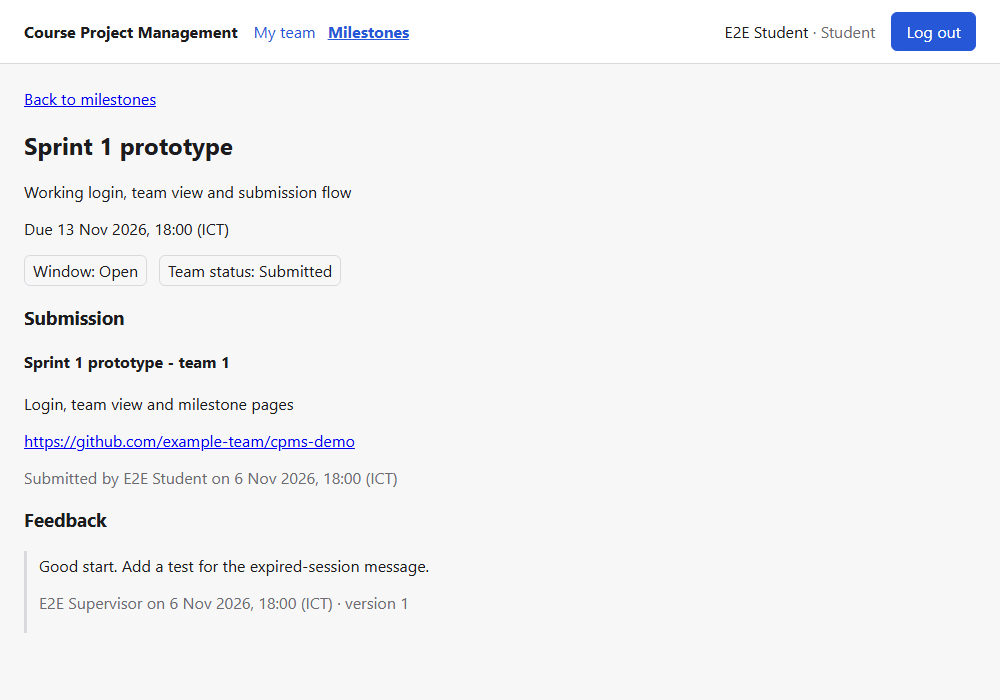

### Scenario 2 — Business-rule and boundary rejections

| | |
|---|---|
| **Features / AC** | F-04 AC-04.2 (deadline must be in the future); F-05 AC-05.3 (no submission after `due_at`, server clock), AC-05.4 (one submission per team per milestone) |
| **Roles** | Supervisor (2a); Student 2 (2b, 2c) |
| **Starting condition** | "F05 past milestone" is due 24 h ago; "F06 submitted milestone" already has a submission |
| **Steps** | 2a. The Supervisor tries to create a milestone with yesterday's date. 2b. Student 2 opens the past milestone, then posts a submission to the API directly, skipping the UI. 2c. Student 2 posts a second submission for the already-submitted milestone. |
| **Expected** | 2a: 400 with a field message, and nothing stored. 2b: the UI offers no form, and the API returns 409 `DEADLINE_PASSED`. 2c: 409 `ALREADY_SUBMITTED`. |
| **Actual** | As expected: Figures 8–9 and responses R1–R3 below. The UI-level late rejection is also automated in TEST-05.3e. That test forces the page to show the form, and the real server still rejects the POST. |

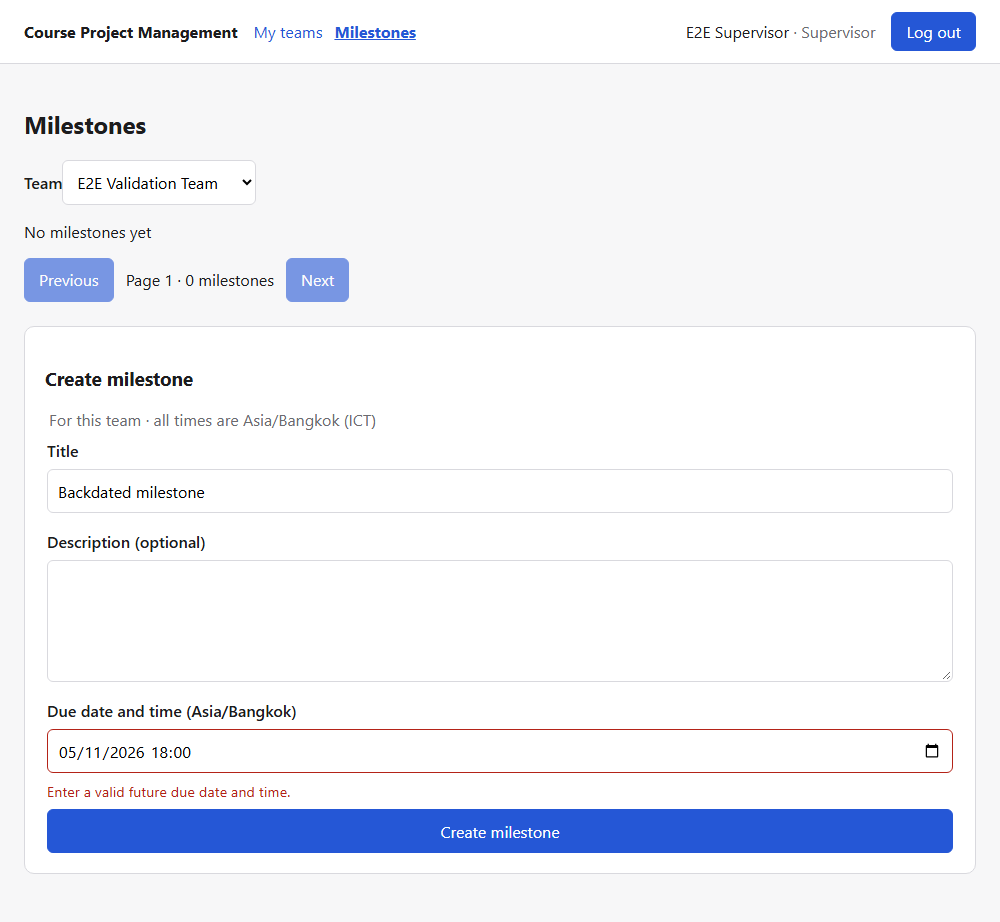

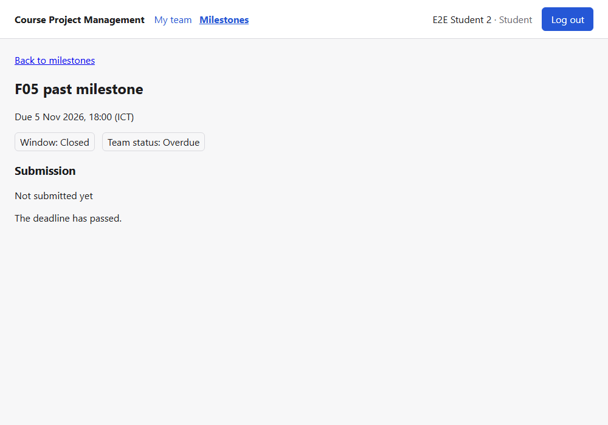

### Scenario 3 — Login, logout and forbidden operations

| | |
|---|---|
| **Features / AC** | F-01 AC-01.2, AC-01.4, AC-01.8; F-02 AC-02.1 (401), AC-02.3 (role, 403), AC-02.4 (ownership, 404); F-04 AC-04.7; F-05 AC-05.9; F-06 AC-06.4 |
| **Roles** | Student, Student 2, Supervisor, unauthenticated |
| **Steps** | 3a. Student logs out, then opens the milestone URL again. 3b. Student signs in with a wrong password. 3c. Student opens the "F06 submitted milestone" URL of another team. 3d. API calls A1–A6 below. |
| **Expected** | 3a: back to sign-in; the old token is rejected (A6). 3b: one generic message for a wrong password or unknown email. 3c and A4: another team's record looks exactly like a missing one (404 `NOT_FOUND`). A1: 401. A2 and A3: 403 for the wrong role. |
| **Actual** | As expected. Figures 10–12 and responses A1–A6. |

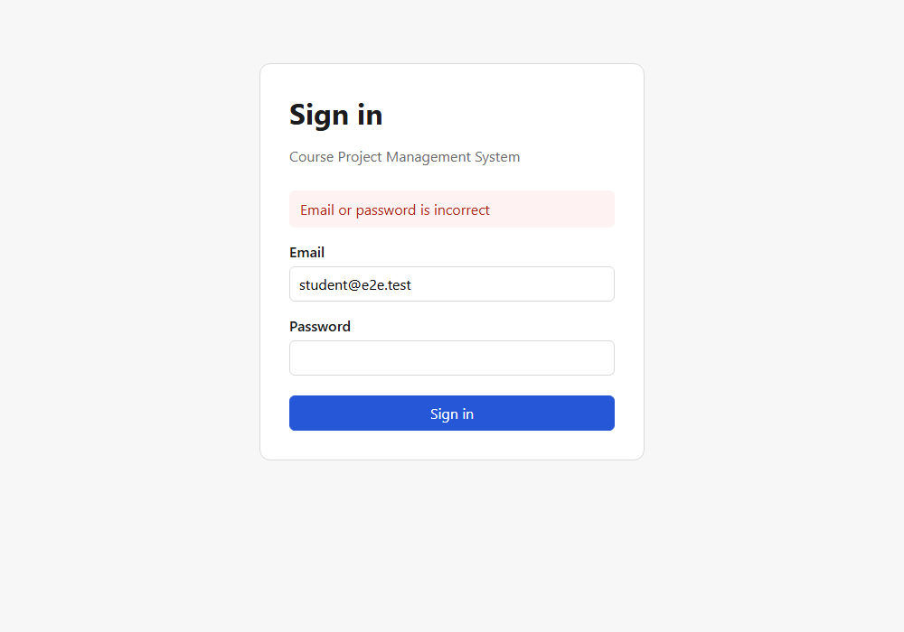

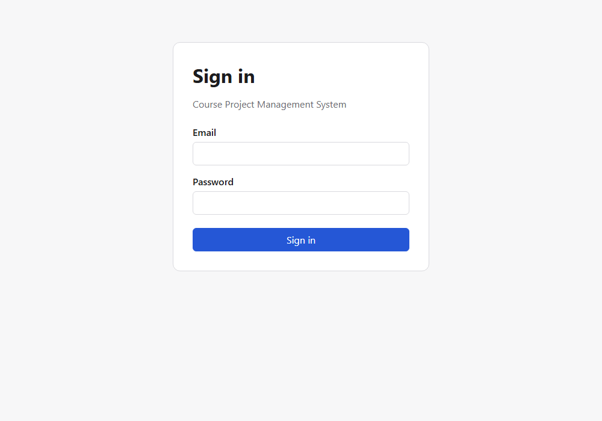

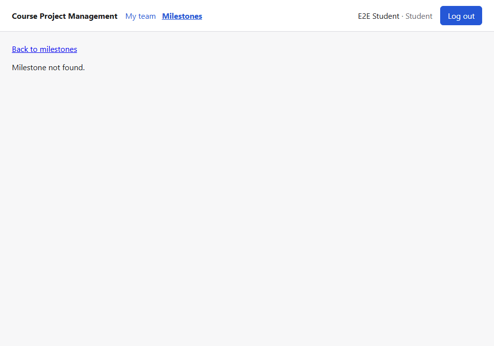

### API responses recorded during the demonstration

These are the real HTTP responses from the API on port 3101 and the `cpms_e2e` database, recorded by the same script (`docs/deliverables/d1/api-evidence.json`). Tokens are not shown.

**R1 late submission (deadline rule)**

```text
POST /api/milestones/2/submissions  (Authorization: Bearer <token>)  body {"title":"Too late","link":"https://example.com/late"}
→ 409  {"error": {"code": "DEADLINE_PASSED", "message": "The deadline for this milestone has passed."}}
```

**R2 second submission (one per milestone)**

```text
POST /api/milestones/3/submissions  (Authorization: Bearer <token>)  body {"title":"Again","link":"https://example.com/again"}
→ 409  {"error": {"code": "ALREADY_SUBMITTED", "message": "Your team has already submitted work for this milestone."}}
```

**R3 milestone with a past deadline**

```text
POST /api/teams/1/milestones  (Authorization: Bearer <token>)  body {"title":"Backdated","dueAt":"2020-01-01T00:00:00+07:00"}
→ 400  {"error": {"code": "VALIDATION_ERROR", "message": "Check the highlighted fields", "fields": {"dueAt": "Enter a valid future due date and time."}}}
```

**A1 unauthenticated protected request**

```text
GET /api/milestones/3/submission  (no token)
→ 401  {"error": {"code": "UNAUTHENTICATED", "message": "Sign in to continue"}}
```

**A2 Student creates a milestone (wrong role)**

```text
POST /api/teams/1/milestones  (Authorization: Bearer <token>)  body {"title":"Mine","dueAt":"2030-01-01T00:00:00+07:00"}
→ 403  {"error": {"code": "FORBIDDEN", "message": "You do not have permission to do this"}}
```

**A3 Student adds feedback (wrong role)**

```text
POST /api/submissions/1/feedback  (Authorization: Bearer <token>)  body {"text":"Self-review"}
→ 403  {"error": {"code": "FORBIDDEN", "message": "You do not have permission to do this"}}
```

**A4 Student reads another team's submission (ownership)**

```text
GET /api/milestones/3/submission  (Authorization: Bearer <token>)
→ 404  {"error": {"code": "NOT_FOUND", "message": "Not found"}}
```

**A5 logout**

```text
POST /api/auth/logout  (Authorization: Bearer <token>)
→ 204  (no body)
```

**A6 same token after logout**

```text
GET /api/auth/me  (Authorization: Bearer <token>)
→ 401  {"error": {"code": "UNAUTHENTICATED", "message": "Sign in to continue"}}
```

## F.3 Build and automated test results

**Tested commit:** `d8bbb4d` (tag `v0.1.0`), checked out directly. 6 Nov 2026, Node v24.14.0, PostgreSQL 16 in Docker.

| Command (working directory) | Result | Passed | Failed | Skipped |
|---|---|---|---|---|
| `npm run typecheck` (server) | exit 0 | — | — | — |
| `npx vitest run` (server, verbose and JSON reporters) | exit 0; 15 files | **209** | 0 | 0 |
| `npm run build` (server) | exit 0 | — | — | — |
| `npx vitest run` (client, verbose and JSON reporters) | exit 0; 7 files | **50** | 0 | 0 |
| `npm run build` (client: `tsc` and Vite) | exit 0 | — | — | — |
| `npx playwright test` (root) | exit 0 | **7** | 0 | 0 (flaky 0) |

Execution output (summary lines, verbatim):

```text
$ [server-typecheck]
  > cpms-server@0.0.0 typecheck
  > tsc -p tsconfig.json --noEmit && tsc -p tsconfig.test.json --noEmit
  exit 0
$ [server-tests]
  Test Files  15 passed (15)
  Tests  209 passed (209)
  Start at  18:01:26
  Duration  123.83s (tests 98%, import 2%)
  exit 0
$ [server-build]
  > cpms-server@0.0.0 build
  > tsc -p tsconfig.json
  exit 0
$ [client-tests]
  Test Files  7 passed (7)
  Tests  50 passed (50)
  Start at  18:03:33
  Duration  2.78s (environment 62%, setup 20%, tests 13%, import 3%, transform 2%, worker 1%)
  exit 0
$ [client-build]
  ✓ built in 165ms
  exit 0
$ [e2e]
  ok 1 e2e\auth.spec.ts:4:1 › TEST-01.7b student signs in, sees Student navigation, logs out and is locked out (3.1s)
  ok 2 e2e\auth.spec.ts:22:1 › TEST-01.8b wrong password shows the generic message (437ms)
  ok 3 e2e\feedback.spec.ts:16:1 › TEST-06.1e Supervisor records feedback and the team's Student reads it with its version (4.0s)
  ok 4 e2e\milestones.spec.ts:17:1 › TEST-04.1e Supervisor creates a persisted milestone and Student reads it after reload (1.4s)
  ok 5 e2e\milestones.spec.ts:46:1 › TEST-04.2e empty list and field feedback, with a real server rejection of a past deadline (707ms)
  ok 6 e2e\submissions.spec.ts:19:1 › TEST-05.1e Student submits work and the assigned Supervisor sees the same submission (1.4s)
  ok 7 e2e\submissions.spec.ts:46:1 › TEST-05.3e the real server rejects a late submission even when the page thinks the window is open (791ms)
  7 passed (24.1s)
  exit 0
```

No test was disabled, skipped or weakened to reach these numbers. Each suite's JSON report is the source of the table in F.4.

## F.4 Acceptance criteria → tests → results

Every Sprint 1 AC from the contracts in Part E maps to at least one automated test whose title starts with its planned `TEST-` ID. The table was generated from the JSON reports of the F.3 run, not edited by hand. The wording of each AC is not repeated here; it is in the feature's contract, Part E §3, and in Part B. Levels: **U** unit, **I** API and database integration (Supertest against PostgreSQL), **C** UI component (Testing Library), **E** end-to-end (Playwright, real browser, API and database).

| AC | Test IDs executed | Test files | Level | Tests | Result |
|---|---|---|---|---|---|
| **AC-01.1** | TEST-01.1, TEST-01.1b | c/auth.test.tsx<br>s/auth.test.ts | IC | 2 | Pass |
| **AC-01.2** | TEST-01.2a, TEST-01.2b, TEST-01.2c, TEST-01.2d | s/auth.test.ts | I | 5 | Pass |
| **AC-01.3** | TEST-01.3 | s/auth.test.ts | I | 1 | Pass |
| **AC-01.4** | TEST-01.4, TEST-01.4b | s/auth.test.ts | I | 2 | Pass |
| **AC-01.5** | TEST-01.5a, TEST-01.5b, TEST-01.5c | s/auth-units.test.ts<br>s/auth.test.ts | UI | 4 | Pass |
| **AC-01.6** | TEST-01.6a, TEST-01.6b, TEST-01.6c | s/auth-units.test.ts<br>s/auth.test.ts | UI | 7 | Pass |
| **AC-01.7** | TEST-01.7a, TEST-01.7b | c/auth.test.tsx<br>e2e/auth.spec.ts | CE | 4 | Pass |
| **AC-01.8** | TEST-01.8a, TEST-01.8b | c/auth.test.tsx<br>e2e/auth.spec.ts | CE | 3 | Pass |
| **AC-01.9** | TEST-01.9 | c/auth.test.tsx | C | 2 | Pass |
| **AC-01.10** | TEST-01.10a, TEST-01.10b, TEST-01.10c | c/api.test.ts<br>c/auth.test.tsx | C | 5 | Pass |
| **AC-02.1** | TEST-02.1, TEST-02.1-auth | s/auth.test.ts<br>s/authz.test.ts | I | 52 | Pass |
| **AC-02.2** | TEST-02.2a, TEST-02.2b, TEST-02.2c | s/authz.test.ts | I | 3 | Pass |
| **AC-02.3** | TEST-02.3a, TEST-02.3b, TEST-02.3c | s/authz.test.ts | I | 3 | Pass |
| **AC-02.4** | TEST-02.4a, TEST-02.4b, TEST-02.4c, TEST-02.4d | s/authz.test.ts | I | 4 | Pass |
| **AC-02.5** | TEST-02.5a, TEST-02.5b, TEST-02.5c, TEST-02.5d, TEST-02.5e, TEST-02.5f | s/authz-units.test.ts<br>s/authz.test.ts | UI | 6 | Pass |
| **AC-03.1** | TEST-03.1a, TEST-03.1b, TEST-03.1c, TEST-03.1d | s/demo-seed.test.ts<br>s/seed-policy.test.ts | UI | 11 | Pass |
| **AC-03.2** | TEST-03.2 | s/demo-seed.test.ts | I | 1 | Pass |
| **AC-03.3** | TEST-03.3, TEST-03.3c | c/team-views.test.tsx<br>s/team-views.test.ts | IC | 2 | Pass |
| **AC-03.4** | TEST-03.4, TEST-03.4c | c/team-views.test.tsx<br>s/team-views.test.ts | IC | 2 | Pass |
| **AC-03.5** | TEST-03.5 | s/demo-seed.test.ts | I | 1 | Pass |
| **AC-03.6** | TEST-03.6, TEST-03.6c | c/team-views.test.tsx<br>s/team-views.test.ts | IC | 2 | Pass |
| **AC-03.7** | TEST-03.7, TEST-03.7c | c/team-views.test.tsx<br>s/team-views.test.ts | IC | 2 | Pass |
| **AC-04.1** | TEST-04.1e, TEST-04.1i | e2e/milestones.spec.ts<br>s/milestones.test.ts | IE | 2 | Pass |
| **AC-04.2** | TEST-04.2c, TEST-04.2e, TEST-04.2i, TEST-04.2u | c/milestone-time.test.ts<br>c/milestones.test.tsx<br>e2e/milestones.spec.ts<br>s/milestones-units.test.ts<br>s/milestones.test.ts | UICE | 28 | Pass |
| **AC-04.3** | TEST-04.3c, TEST-04.3i | c/milestone-time.test.ts<br>c/milestones.test.tsx<br>s/milestones.test.ts | IC | 7 | Pass |
| **AC-04.4** | TEST-04.4u | s/milestones-units.test.ts | U | 4 | Pass |
| **AC-04.5** | TEST-04.5c | c/milestones.test.tsx | C | 2 | Pass |
| **AC-04.6** | TEST-04.6c, TEST-04.6i | c/milestones.test.tsx<br>s/milestones.test.ts | IC | 3 | Pass |
| **AC-04.7** | TEST-04.7i | s/milestones.test.ts | I | 2 | Pass |
| **AC-04.8** | TEST-04.8c, TEST-04.8i | c/milestones.test.tsx<br>s/milestones.test.ts | IC | 3 | Pass |
| **AC-05.1** | TEST-05.1, TEST-05.1b, TEST-05.1e | e2e/submissions.spec.ts<br>s/submissions.test.ts | IE | 3 | Pass |
| **AC-05.2** | TEST-05.2a, TEST-05.2b, TEST-05.2c, TEST-05.2d | c/submission.test.tsx<br>s/submissions-validate.test.ts<br>s/submissions.test.ts | UIC | 30 | Pass |
| **AC-05.3** | TEST-05.3a, TEST-05.3b, TEST-05.3e | e2e/submissions.spec.ts<br>s/submissions-units.test.ts<br>s/submissions.test.ts | UIE | 6 | Pass |
| **AC-05.4** | TEST-05.4a, TEST-05.4b | s/submissions.test.ts | I | 2 | Pass |
| **AC-05.5** | TEST-05.5a, TEST-05.5b | s/submissions.test.ts | I | 2 | Pass |
| **AC-05.6** | TEST-05.6 | c/submission.test.tsx | C | 1 | Pass |
| **AC-05.7** | TEST-05.7 | c/submission.test.tsx | C | 4 | Pass |
| **AC-05.8** | TEST-05.8a, TEST-05.8b, TEST-05.8c | s/submissions-units.test.ts<br>s/submissions.test.ts | UI | 6 | Pass |
| **AC-05.9** | TEST-05.9a, TEST-05.9b | s/submissions.test.ts | I | 2 | Pass |
| **AC-06.1** | TEST-06.1, TEST-06.1e | e2e/feedback.spec.ts<br>s/feedback.test.ts | IE | 2 | Pass |
| **AC-06.2** | TEST-06.2a, TEST-06.2b, TEST-06.2c | c/feedback.test.tsx<br>s/feedback-validate.test.ts<br>s/feedback.test.ts | UIC | 15 | Pass |
| **AC-06.3** | TEST-06.3 | s/feedback.test.ts | I | 2 | Pass |
| **AC-06.4** | TEST-06.4a, TEST-06.4b, TEST-06.4c | s/feedback.test.ts | I | 3 | Pass |
| **AC-06.5** | TEST-06.5a, TEST-06.5b, TEST-06.5c | c/feedback.test.tsx | C | 4 | Pass |
| **AC-SR1.1** | TEST-SR1.1-auth | s/auth.test.ts | I | 1 | Pass |

File prefixes: `s/` = `server/tests/`, `c/` = `client/tests/`, `e2e/` = Playwright specs. **45 AC with automated tests, all passing.** AC-SR2.1 and AC-SR2.2 are manual checks (below). Some AC-02.1 cases run once per protected endpoint, so one ID can count several tests.

**Manual checks** (not automated, listed separately):

| Check | AC | Result |
|---|---|---|
| TEST-SR2.1: secrets stay out of Git and the client bundle | AC-SR2.1 | **Pass** at `v0.1.0`, checked 6 Nov 2026. Only `server/.env.example` and `client/.env.example` are tracked, and `.gitignore` excludes `.env` and `.env.*`. No `.env` file appears anywhere in the git history. The built client bundle contains no `DATABASE_URL`, connection string or demo/E2E password. |
| TEST-SR2.2: the teammate follows the README from a fresh clone to passing tests in ≤ 15 min | AC-SR2.2 | **Time target met, with one deviation from the README.** @Earth2509 cloned `v0.1.0` (`d8bbb4d`) fresh on Windows (Node v24.14.0) and reached passing tests (209 server, 50 client, 7 E2E) in **1 min 37 s**, against a 15 min target, reported on PR #41 on 6 Nov 2026. In the first attempt, `npm install` printed `Generated Prisma Client (v5.22.0)` from its `postinstall` step, but Vitest's global setup then failed with `Error: @prisma/client did not initialize yet. Please run "prisma generate" and try to import it again.` The timed retry added an explicit `npx prisma generate` in `server/` and passed. PostgreSQL was already running and the npm and browser caches were warm. @Nuggetkub's fresh clone of the same tag did not hit the error, and the cause was not identified. PR #41 adds the explicit step to the README, released in `v0.1.1`. |

## F.5 Selected test excerpts

**Domain rule — the deadline (BR, AC-05.3).** `server/tests/submissions.test.ts`. The app is created with an injected server clock (`createApp({ now: () => clock })`), so the test controls "now" around the due time `DUE`:

```ts
it("TEST-05.3b accepts at due − 1 s and at due, rejects at due + 1 s using the server clock", async () => {
  const [m1, m2, m3] = [await milestone(f.teamA.id), await milestone(f.teamA.id), await milestone(f.teamA.id)];
  clock = at(-1000);
  expect((await submit("sA", m1.id)).status).toBe(201);
  clock = at(0);
  expect((await submit("sA", m2.id)).status).toBe(201);
  clock = at(1000);
  const late = await submit("sA", m3.id, { ...valid, submittedAt: DUE.toISOString() });
  expect(late.status).toBe(409);
  expect(late.body).toEqual({ error: { code: "DEADLINE_PASSED", message: "The deadline for this milestone has passed." } });
  expect(await rows(m3.id)).toBe(0);
});
```

The late request also sends a forged `submittedAt`, which the server ignores. The final assertion checks that no row reached the database.

- **Red:** at the test-first commit `b5321a0` (5 Nov 16:03), before any F-05 route existed, this test failed with `expected 404 to be 201`.
- **Green:** passed at `bdbf2fc` (5 Nov 16:08) and at `v0.1.0`: `✓ tests/submissions.test.ts > … > TEST-05.3b …`.

**Role and ownership restriction (AC-06.4, built on F-02).** `server/tests/feedback.test.ts`, with the shared assertions from `server/tests/support/authz.ts`:

```ts
// support/authz.ts
export function expectForbidden(res: Response): void {   // wrong role (BR-01)
  expect(res.status).toBe(403);
  expect(res.body).toEqual(FORBIDDEN);
}
export function expectHidden(res: Response): void {      // other team / missing record (DEC-10)
  expect(res.status).toBe(404);
  expect(res.body).toEqual(NOT_FOUND);
}

// feedback.test.ts — sA is in team A, sB in team B, s0 has no team, pA supervises A, pB supervises B
it("TEST-06.4a forbids students from recording feedback, even on their own team", async () => {
  expectForbidden(await post("sA"));
  expectForbidden(await post("sB"));
  expect(await rows()).toBe(0);
});

it("TEST-06.4b hides feedback from outsiders exactly like a missing submission", async () => {
  expect((await post("pA")).status).toBe(201);
  for (const name of ["sB", "s0", "pB"] as const) expectHidden(await list(name));
  expectHidden(await post("pB"));
  for (const id of ["999999", "abc", "0"]) {
    expectHidden(await list("sA", id));
    expectHidden(await post("pA", { text: "x" }, id));
  }
  expect(await rows()).toBe(1);
});
```

- **Red:** at the test-first commit `c992c56` (6 Nov), both tests failed: `expected 404 to be 201 / 403`, because the routes were not mounted.
- **Green:** both passed at `c076ad1` and at `v0.1.0`.

## F.6 Engineering workflow and history

Sampled pairs: one feature led by each student, each reviewed by the other.

| | Issue #9 — F-04 Milestones | Issue #10 — F-05 Submissions |
|---|---|---|
| **Contract** | `docs/sprints/sprint-1/F-04-milestone.md` (Part E) | `docs/sprints/sprint-1/F-05-submission.md` (Part E) |
| **Branch** | `feature/9-f04-milestones` from `staging/sprint-1` | `feature/F-05-submission` from `staging/sprint-1` |
| **PR(s)** | #35 | #31 (contract v0.1), #36 (implementation) |
| **Author** | @Earth2509 (Codex-assisted) | @Nuggetkub (Claude Code-assisted) |
| **Reviewer** | @Nuggetkub | @Earth2509 |
| **Substantive review** | Reviewed `8adf0b1`: independently re-ran 124/124 server, 33/33 client and 4/4 E2E tests. Checked out the test-first commit `dd83ca1` and reproduced the API red run the author could not capture: 7 integration cases failed with `expected 404 to be 201`. Checked the 401 → 403 → 404 → 400 guard order, that forged `teamId`/`createdBy` are ignored, and the edge cases of `parseDueAt` (Nov 31, Feb 29, `24:00`, `+14:30`). Approved. | Reviewed through `72bb4c0`: independently re-ran 180/180 server and 45/45 client tests. Checked Student-only writes, identical cross-team 404s, guard order before body parsing, the server-set author, version and time, the inclusive deadline, and the unique key under concurrent submits. Finding: §5 of the contract claimed every test was seen failing, but §6 records that TEST-05.3a already passed. Fixed in `67e6c4f`, then approved. |
| **Staging merge** | `8d1a66c`, 5 Nov 16:24 UTC (merged by @Nuggetkub) | `50d2ce7` (#31), 5 Nov 14:59; `f0ec131` (#36), 5 Nov 16:35 UTC (merged by @Earth2509) |
| **Release to main** | PR #39 → `d8bbb4d`, tag `v0.1.0`, 6 Nov 08:37 UTC | same |

**History sequence: contract and tests before implementation** (commit dates in UTC):

| Feature | Contract | Migration | Failing tests (red) | Implementation (green) |
|---|---|---|---|---|
| F-04 | `33e4f05` 5 Nov 15:13 | `ed26f11` 15:14 | `dd83ca1` 15:16. Client: 10/10 new cases failed (author). API: 7/7 failed on assertions (reproduced by the reviewer). | `143c4c2` 15:25 |
| F-05 | `393aec7` 4 Nov 15:53 (v0.1, PR #31); `5c093ec` 5 Nov 15:55 (v0.2) | `91ab4e1` 15:56 | `b5321a0` 16:03. Server: 33 failed, including 22/22 in `submissions.test.ts`. Client: 7/7. E2E: 2/2. | `bdbf2fc` 16:08 |
| F-06 | `d95acf9` 6 Nov | `59cb392` | `c992c56`. Server: 19 failed, including 10/10 in `feedback.test.ts`. Client: 5/5. E2E: 1/1. | `c076ad1` |

Each contract's §6 records the exact red and green commands and counts, including limits. For example, a validator file that failed to load is not counted as behavioural red.


**Release reference:** PR #39 (`staging/sprint-1` → `main`). Reviewed and approved by @Earth2509, who re-ran the client tests and both builds independently and relied on the author's database-backed runs. Merged as `d8bbb4d` and tagged `v0.1.0`. PR #40 synced `staging/sprint-1` with `main` afterwards. The documentation release `v0.1.1` followed the same path: PR #41 into staging, then a reviewed release PR to `main`.

**Final board status** (GitHub project #4, 6 Nov 2026): every Sprint 1 item is **Released**. That covers #1–#11 (documents, scaffold, F-01 to F-06), the review PRs #14, #33 and #35, the Lab 5 audit #16 and the release PR #39. #12 (this deliverable) is In progress. The Lab 5 issues #15 and #17–#24 are in Backlog, due 15 Nov.

## F.7 Contributions

Sprint 1, up to release `v0.1.0` (`d8bbb4d`). Each PR was approved by the student who did not author it; authors never approved their own work. Commits on `main` up to `v0.1.0`: 59 by @Nuggetkub, and 25 authored plus 15 merge commits by @Earth2509 (git name "Pattharapon Kijjanukij").

| Date | Item (Issue/PR/doc) | 67070501046 (@Nuggetkub) | 67070501069 (@Earth2509) |
|---|---|---|---|
| 2026-11-03 | Repository, branch protection, templates, board setup | Author | Reviewer |
| 2026-11-03 | PR #14 SRS baseline (Part A) | Author | Reviewer (approved) |
| 2026-11-03 | PR #25 / Issue #5 app scaffold (client, server, Prisma, E2E) | Author | Reviewer (approved) |
| 2026-11-03 | PR #26 / Issue #2 feature inventory and traceability (Part B) | Author | Reviewer (approved after two review rounds) |
| 2026-11-04 | PR #30 System-Level SDS and three-sprint plan (Parts C, D) | Reviewer (approved) | Author |
| 2026-11-04 | PR #27 / Issue #6 F-01 authentication and session | Author | Reviewer (approved; found the 72-byte bcrypt limit gap) |
| 2026-11-04 | PR #29 / Issue #7 F-02 role and ownership authorization | Author | Reviewer (approved; asked for malformed-JSON check order) |
| 2026-11-04 | PR #28 / Issue #8 F-03.1 course and team data, demo seed | Reviewer (approved) | Author |
| 2026-11-05 | PR #32, #34 / Issue #8 F-03.2 protected team views | Reviewer (approved; found the session-expiry gap, AC-01.10) | Author |
| 2026-11-05 | PR #33 F-01 session expiry (AC-01.10) | Author | Reviewer (approved; found the stale-401 bug, fixed with TEST-01.10c) |
| 2026-11-05 | PR #35 / Issue #9 F-04 milestones | Reviewer (approved; reproduced the API red run at `dd83ca1`) | Author (Codex-assisted) |
| 2026-11-05 | PR #31, #36 / Issue #10 F-05 submissions | Author | Reviewer (approved; DoD wording finding) |
| 2026-11-06 | PR #37 / Issue #11 F-06 feedback (taken over from @Earth2509, see Issue #11) | Author | Reviewer (approved and merged) |
| 2026-11-06 | PR #38 / Issue #16 Lab 5 cloud-readiness audit | Reviewer (requested a README table fix, then approved) | Author |
| 2026-11-06 | PR #39 release `v0.1.0`; PR #40 staging sync | Author (regression run, release PR) | Reviewer (approved, merged, tagged `v0.1.0`) |
| 2026-11-06 | Issue #12 D1 evidence (Part F, this PDF) | Author | Reviewer |

## F.8 AI-use declaration

Both students used AI coding assistants. Every AI-produced change went through the same gate as any other change: a contract first, tests run locally against disposable schemas, and a PR approved by the other student. Test results quoted in this project come from commands actually run, not from an assistant's claim.

| Date | Tool | Task assisted | Verified by |
|---|---|---|---|
| 2026-11-03 | Claude Code | Read project specs; drafted project plan, repository scaffold, Issue/PR templates, board setup | 67070501046 |
| 2026-11-03 to 06 | Claude Code (@Nuggetkub) | Drafted SRS, feature inventory and traceability; F-01, F-02, F-05 and F-06 contracts, failing tests and implementations; review comments on @Earth2509's PRs; release PR | 67070501046 read and ran each change; @Earth2509 reviewed every PR |
| 2026-11-05 | OpenAI Codex | Assisted @Earth2509 with F-04 contract, additive migration, API/UI and automated tests. Tests run locally against isolated schemas; verification and TDD limitations recorded in the F-04 contract. | Automated local checks; @Nuggetkub peer review (PR #35, approved) |
| 2026-11-04 to 06 | OpenAI Codex (@Earth2509) | F-03 data seed and protected team views (PRs #28, #32, #34), system design and sprint plan (#30), milestone implementation and tests (#35), cloud-readiness audit (#38), and PR reviews | 67070501069 ran the server, client and E2E suites locally and checked the terminal results, including the timed fresh-clone retry (TEST-SR2.2); @Nuggetkub peer review of each PR |
| 2026-11-06 | Claude Code (@Nuggetkub) | D1 evidence: ran the regression suite on `v0.1.0`; a temporary Playwright script captured the Part F screenshots and API responses from the real app on the disposable `cpms_e2e` schema; drafted Part F and assembled the PDF | 67070501046 checked every screenshot and result; @Earth2509 reviews the evidence PR |

## F.9 Known limitations and incomplete work

- **Failed or skipped tests:** none at `v0.1.0`. The figures are 209/209 server, 50/50 client and 7/7 E2E, with 0 skipped.
- **Flaky tests fixed before release:** two client tests (TEST-05.7 and TEST-04.6c) had a timing race that failed about 1 run in 15. Both now create their pending response before rendering. Fixed in `72bb4c0` and `8eab9aa`, after which 15 and 20 consecutive runs passed.
- **TDD evidence limits:**
  - F-04's API red run was reproduced by the reviewer rather than captured by the author, because Docker was unavailable at the time.
  - Some regression tests were added together with their implementation and are not claimed as red-first. The contracts' §6 lists them.
- **Not in Sprint 1, by plan:**
  - Late window, resubmission, versions after the first (F-08, F-09); grades (F-10); team management UI (F-07); progress board, overview and CSV export (F-11 to F-13).
  - Self-registration and password recovery, which are excluded in the SRS.
- **Deployment:** no Docker image, CI pipeline or GCP deployment yet; these belong to Lab 5 (#17–#21). The app is designed for it: it reads `PORT`, binds `0.0.0.0`, stores sessions in PostgreSQL and has `/api/ready` (PR #38).
- **Home page:** after sign-in, the Home page still shows the placeholder text "Coming in a later Sprint 1 feature." Users reach their work through the My team / My teams and Milestones links. A role-specific home page belongs to the Sprint 3 progress board (F-11, F-12).
- **AC-SR2.2:** in the timed fresh-clone walkthrough (NFR-08), the README of `v0.1.0` needed an extra `npx prisma generate` on one Windows machine. The target time was still met (1 min 37 s, see F.4). The README fix is in `v0.1.1`.
