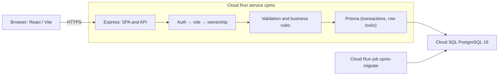
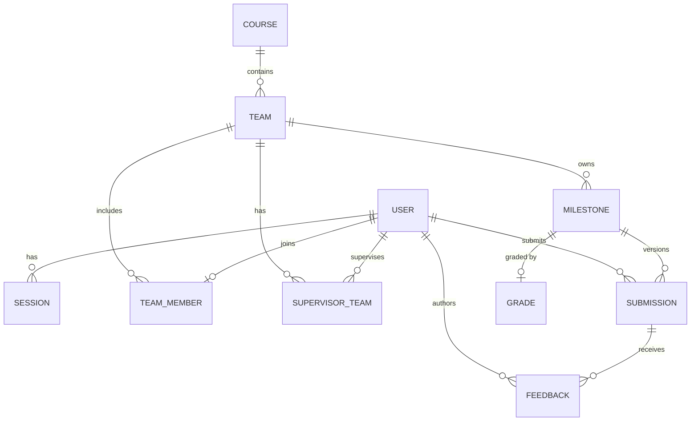

# System-level software design specification

Version 0.5 · 2026-11-25 · D2 Part D (#87): matches staging `4f56155` (F-01 to F-09, F-10 server) and PR #94 (F-11 phase 1); the F-10 Grade UI, F-11 phase 2, F-12 and F-13 marked as approved designs not yet built. (v0.4: 2026-11-24, Lab 7 CR-01, #73; v0.3: 2026-11-04, D1 Part C, Issue #3, PR #30 re-review.)

This document describes the system design. The [SRS](srs.md) defines required behavior, the [decision log](decisions.md) records design decisions, the [traceability matrix](traceability.md) maps requirements to verification and the [change register](changes.md) lists findings since Sprint 1. Feature contracts specify concrete endpoints and tests.

**What is built (25 Nov 2026):**
- **Released on `main`** (`v0.4.0`, `aa191ba`, deployed revision `cpms-00008-l48`): F-01 to F-06 and CR-01.
- **Integrated on `staging/sprint-2`** (`4f56155`), release `v0.5.0` planned: F-07, F-08, F-09 and the F-10 server.
- **On PR #94**, for `v0.6.0` after `v0.5.0` (DEC-15): F-11 phase 1.
- **Design only** (contracts approved): the F-10 Grade UI, F-11 phase 2, F-12, F-13. Their rows below say "planned".

## Architecture and enforcement

- **Browser:** React, Vite and TypeScript handle routing, role-specific navigation, accessible status messages and field feedback. UI visibility is not an authorization boundary.
- **API:** Express and TypeScript authenticate requests, enforce role and ownership, validate input and apply business rules before writing. Prisma scopes reads by authenticated identity and supplies transactions for multi-row writes.
- **Database:** PostgreSQL 16 stores identities, assignments, sessions and project records. Foreign keys, uniqueness and indexes protect relationships and support scoped queries. Vitest/Supertest cover unit and API behavior against a real PostgreSQL schema; Playwright covers browser workflows.
- **Runtime:** during development Vite and Express run separately. In production one Express container serves the built client and the API, with SPA fallback outside the API namespace.

## Data model

| Entity | Relationships and integrity |
| --- | --- |
| User / Session | One role per User (Student or Supervisor), unique normalized email, password hash only. User 1:N Session; each session stores a unique token hash and expiry. |
| Course / Team | Course 1:N Team. Course code is unique; team name is unique within its course. One offering per deployment (AS-01): F-07 creates teams only when exactly one course exists. |
| TeamMember | Team 1:N membership rows, each pointing to a student. Student ID is the membership key, so a student has zero or one team. F-07 adds and removes rows; removal is refused for an author of any version (BR-16). |
| SupervisorTeam | Team N:M supervisors through assignments; the composite key prevents duplicates and supports co-supervision. F-07 assigns the creator. |
| Milestone | Team 1:N Milestone. Title, description and UTC due time (F-04). F-08 adds an optional late window and a manual close. There is no delete endpoint (BR-14). |
| Submission | Milestone 1:N versions. The version number is unique per milestone; the next version is allocated inside a transaction that holds the milestone lock, with a retry on a version collision (F-09). Earlier versions are never changed. Versions made in the late window are marked Late. |
| Feedback | Each feedback record points to exactly one Submission version and its supervisor author; newer versions don't move it (BR-10). |
| Grade (F-10) | One optional row per milestone (a team grade): the current draft and the released snapshot, kept apart. Students only ever see the released snapshot, through the shared `studentGrade(row)` projection (also used by F-11 phase 2 and F-13). |

For nested records, resolve the owning team and apply the same ownership check as team routes. Never trust client-supplied owner, author, role, timestamps or version numbers. Server time controls writes. The window and the team status are separate values (DEC-13): a manual close changes the window, not the team status. Late-window writes are marked Late, including a first submission (DEC-14).

### Major fields

Rows mirror [the Prisma schema](../server/prisma/schema.prisma) and its nine migrations, using database column names. The Grade table is integrated on staging and not yet deployed.

| Entity | Fields and key constraints |
| --- | --- |
| User | `id` PK, `email` unique, `name`, `role`, `password_hash`, `created_at` |
| Session | `id` PK, `token_hash` unique, `user_id` FK, `created_at`, `expires_at` |
| Course | `id` PK, `code` unique, `name` |
| Team | `id` PK, `course_id` FK, `name`; unique (`course_id`, `name`) |
| TeamMember | `student_id` PK and User FK, `team_id` FK |
| SupervisorTeam | `supervisor_id` User FK and `team_id` Team FK; composite PK |
| Milestone | `id` PK, `team_id` FK, `title` (1–120), `description` (≤ 2000), `due_at` (`timestamp(3)` holding UTC; at least 24 h after server time on create and extend, CR-01), `created_by` FK, `created_at`; F-08: `late_until` (nullable, after `due_at`), `closed_at` and `closed_by` (nullable, set together); index (`team_id`, `due_at`, `id`) |
| Submission | `id` PK, `milestone_id` FK (team scope from `Milestone.team_id`), `version`, `title` (1–120), `description` (≤ 2000), `link` (absolute HTTP/HTTPS), `submitted_by` Student FK, `submitted_at` (server time); F-09: `late` boolean (default false); unique (`milestone_id`, `version`) |
| Feedback | `id` PK, `submission_id` FK to a specific version, `supervisor_id` User FK, `text` (1–2000 after trimming), `created_at`; index (`submission_id`, `created_at`, `id`) |
| Grade | `milestone_id` PK and FK (team from the milestone), `draft_score`, `updated_by`, `updated_at`, nullable `released_score`, `released_by`, `released_at`. SQL CHECK constraints: scores 0–100; release fields all set or all null (migration `20261125150000_add_grades`) |

Use reviewed Prisma migrations in order. Deployment runs `prisma migrate deploy` in the `cpms-migrate` job, never schema push or reset. Sprint 2 migrations are additive (nullable or defaulted columns), so `v0.4.0` stays a safe rollback target. The opt-in demo seed uses environment-supplied passwords, can be repeated without duplicating fixtures, and runs one invocation per schema at a time. See [F-03.1](sprints/sprint-1/F-03-seed.md).

### Concurrency

| Write | Rule | Feature |
| --- | --- | --- |
| Milestone edit or close | Locks the milestone row (`SELECT … FOR UPDATE`) inside a transaction, then re-reads it | F-08 |
| Submission | Locks the milestone, then the submitter's membership row; decides closed → deadline → version `max + 1` (Late in the late window). A collision on (`milestone_id`, `version`) is retried in a fresh transaction up to 3 times, then 409 `SUBMISSION_CONFLICT`; any other error is passed on | F-08, F-09, F-07 |
| Member removal | Locks the membership row only, checks for authored work, then deletes. **Lock order is milestone → membership** everywhere, so these writes can't deadlock | F-07 |
| Grade save and release | Lock the milestone row, re-check the Supervisor's assignment, then upsert the draft or copy it to the released snapshot. A repeat release of an unchanged score keeps the original record | F-10 |
| Paged lists | One RepeatableRead snapshot for a page and its count. The F-11 board also reads its team (scoped) and validates the page inside the snapshot | F-04, F-11 |

Race tests hold one side's transaction open and check, through `pg_blocking_pids`, that the other side really waits. They must fail when the lock is removed (changes.md D-01, D-04).

## API, identity and permissions

API routes live under `/api` and return JSON, except intentional no-content responses and the planned CSV export. Failures use `{ "error": { "code": "...", "message": "..." } }`, with field messages for validation. They never expose SQL, stack traces or raw internal errors. For protected requests the order is authentication (401) → role (403) → ownership (404) → body or query validation (400) → business rule (409). Cross-team access gets the same 404 as a missing record (DEC-10).

- Use camelCase JSON keys, positive integer IDs and ISO 8601 UTC timestamps. Convert deadlines to Asia/Bangkok for display.
- Use 200 for reads, 201 for creation and 204 for no-content operations.
- Lists return 50 rows per page, with `page`, `pageSize` and `total`.

| Method and path | Role | Feature | Status |
| --- | --- | --- | --- |
| `POST /api/auth/login`, `POST /api/auth/logout`, `GET /api/auth/me` | Any | F-01 | Released |
| `GET /api/teams/mine` | Student | F-03.2 | Released |
| `GET /api/teams` | Supervisor | F-03.2 | Released |
| `POST /api/teams`, `GET /api/teams/:teamId`, `GET /api/teams/:teamId/member-candidates`, `POST /api/teams/:teamId/members`, `DELETE /api/teams/:teamId/members/:studentId` | Supervisor | F-07 | Integrated |
| `GET` / `POST /api/teams/:teamId/milestones` | Team (read), Supervisor (create) | F-04 | Released |
| `GET /api/milestones/:milestoneId` | Team | F-04 | Released |
| `PATCH /api/milestones/:milestoneId`, `POST /api/milestones/:milestoneId/close` | Supervisor | F-08 | Integrated |
| `POST /api/milestones/:milestoneId/submissions` | Student | F-05, F-09 | Released (versions integrated) |
| `GET /api/milestones/:milestoneId/submission` (latest), `GET …/submissions` (history) | Team | F-05, F-09 | Latest released; history integrated |
| `GET` / `POST /api/submissions/:submissionId/feedback` | Team (read), Supervisor (write) | F-06 | Released |
| `GET /api/teams/:teamId/progress` | Team | F-11 | PR #94 |
| `GET`, `PUT /api/milestones/:milestoneId/grade`, `POST …/grade/release` | Team (read), Supervisor (write) | F-10 | Integrated (server); UI planned |
| `GET /api/overview`, `GET /api/overview/export` | Supervisor | F-12, F-13 | Planned |

| Operation | Student | Supervisor |
| --- | --- | --- |
| Session identity/logout | Own session | Own session |
| Team view | Own roster; no team → 404 and the FR-05 empty state | Assigned teams; create teams and manage their members (F-07) |
| Milestones | Read own team's, with window and team status | Read, create, edit, extend, set a late window and close for assigned teams (F-04, F-08) |
| Submissions | Submit versions for own team while the window accepts work; read the history | Read assigned teams' versions; no submission writes |
| Feedback and grades | Read own team's feedback per version; the released grade only (API built, UI planned) | Write feedback on any version; save and release grades (API built, UI planned) |
| Progress and reporting | Own progress board (F-11) | Overview, filters and CSV for assigned teams (planned) |

`POST /api/auth/login` verifies bcrypt (work factor at least 10; default 12) and returns an opaque token and public user data. Passwords longer than 72 bytes are rejected, never truncated. Unknown email and wrong password return the same 401. The browser keeps the token in sessionStorage and sends it as Bearer; PostgreSQL stores only its SHA-256 hash. Sessions expire after a fixed eight hours, and logout revokes the presented session. Tokens and passwords are never logged. See [authentication](sprints/sprint-1/F-01-auth.md) and [authorization](sprints/sprint-1/F-02-authz.md).

## Screens and states

| Screen | Navigation and states |
| --- | --- |
| Login and protected shell | Anonymous access redirects to login. Field validation, safe sign-in errors, and loading while the session is checked. A 401 during use returns to login with an expiry notice. |
| My team / My teams | Student opens own roster; Supervisor opens assigned teams. Loading, role-specific empty text, safe error with Retry. |
| Team management (F-07) | Supervisors create a team, open a roster, search and page through eligible students and confirm removals. Recoverable errors keep inputs; authors stay in the roster. |
| Milestones (F-04) | List with window and team status, pagination, and the Supervisor create form with field errors. |
| Milestone page (F-05, F-06, F-08, F-09) | Latest version, Earlier versions with their own feedback, "Submit a new version" while the window accepts work (with a Late notice), Supervisor edit/extend/late window/close with confirmation. |
| Progress (F-11, Student) | Table per milestone: due (ICT), window, team status, latest version with a Late badge, feedback status. Stacked rows on narrow screens; no horizontal scrolling. No grade column in phase 1. |
| Grades, overview, export (**planned**) | Grade section on the milestone page (F-10 AC-10.5; the API is built); Supervisor Overview with filters kept in the URL (F-12) and Download CSV (F-13). |

## Configuration and delivery

`DATABASE_URL` is required server-side; `PORT`, `HOST`, `CLIENT_ORIGINS`, `NODE_ENV`, `CLIENT_DIST_DIR` and `BCRYPT_COST` control runtime configuration. `SEED_DEMO_DATA`, `STUDENT_DEMO_PASSWORD` and `SUPERVISOR_DEMO_PASSWORD` are for opt-in demo seeding; `TEST_DATABASE_URL` is for a disposable test database. See the [environment example](../server/.env.example). Never commit `.env` or put secrets in Vite variables.

**Delivery (in place since Lab 5):**
1. **Pull request:** `test-and-docker` runs on every PR into `main` or `staging/**` and is required by the `protect-main` ruleset (1 approval, up-to-date branch).
2. **Merge to `main`:** `deploy.yml` builds one Docker image, pushes it to Artifact Registry, runs the `cpms-migrate` job (`prisma migrate deploy`), deploys a new revision of the Cloud Run service `cpms` and smoke-tests `/api/health` (which reports the commit) and `/api/ready`.
3. **Credentials:** GitHub Actions authenticates with Workload Identity Federation (no service-account keys). Secret Manager supplies database credentials and demo passwords only to the job that needs them.
4. **Rollback:** the previous revision is kept. Traffic can return to it when the database is compatible; Sprint 2 migrations are additive.

**Branches:** feature branches merge into `staging/sprint-N`, and each release is a reviewed PR from staging to `main` with a tag (DEC-11). For D2, F-11 phase 1 also goes through `staging/sprint-2` (DEC-15). Playwright runs locally against an isolated `cpms_e2e` schema; it isn't part of CI.
